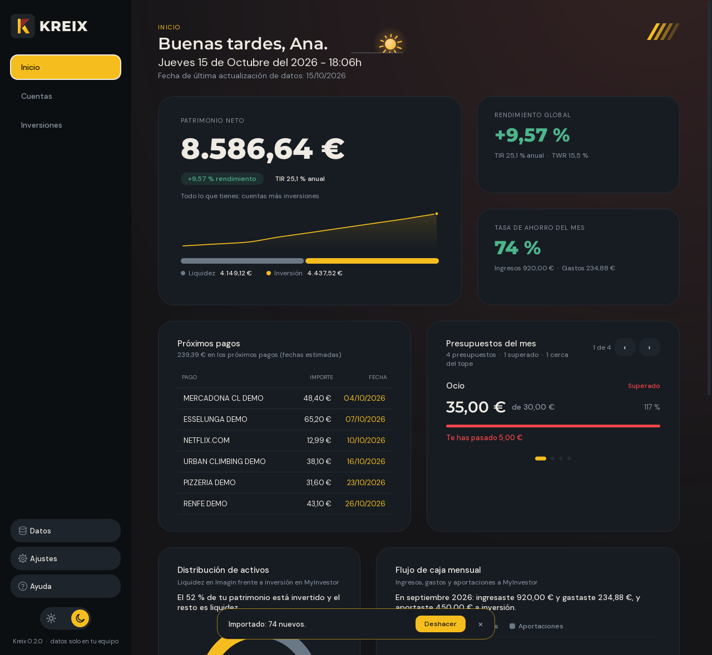
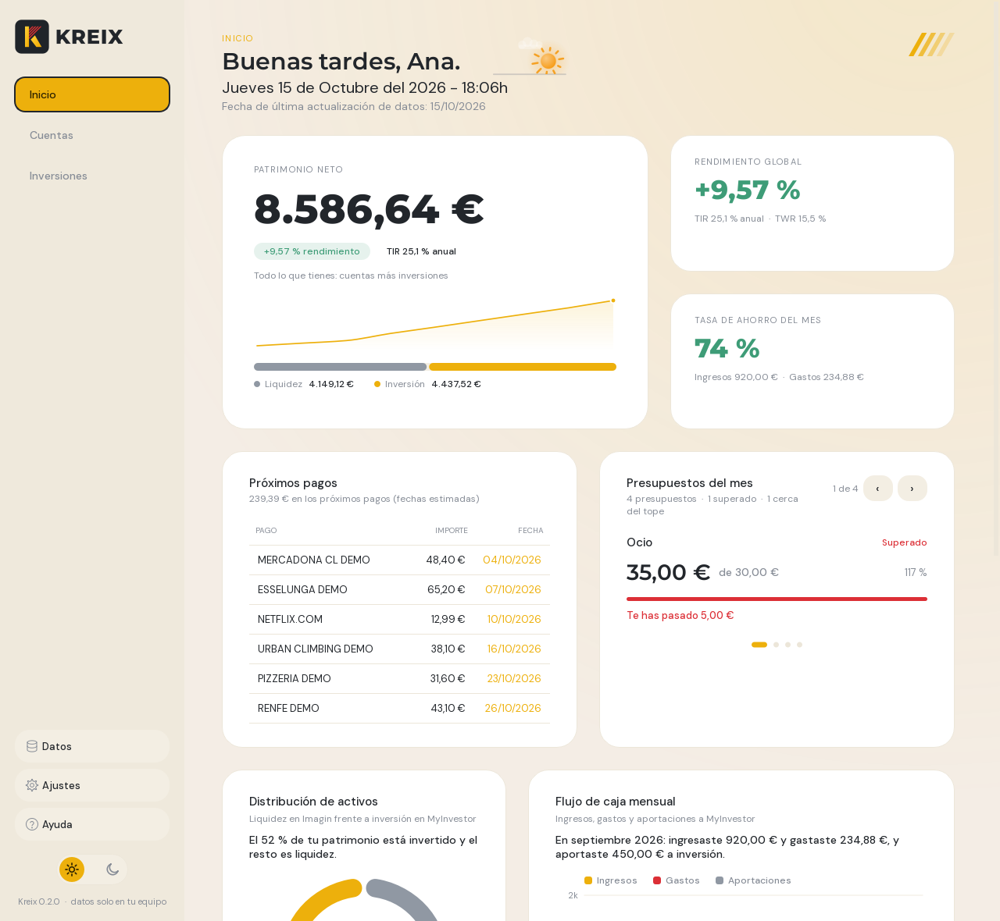
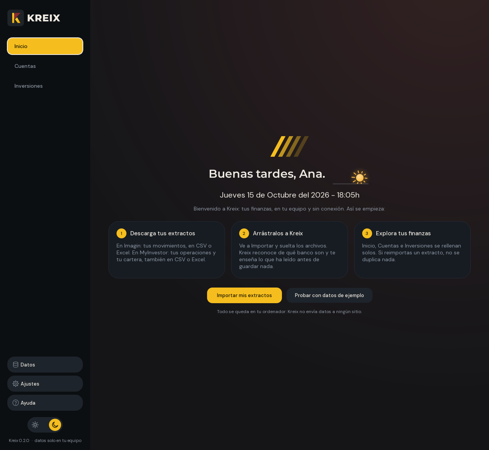
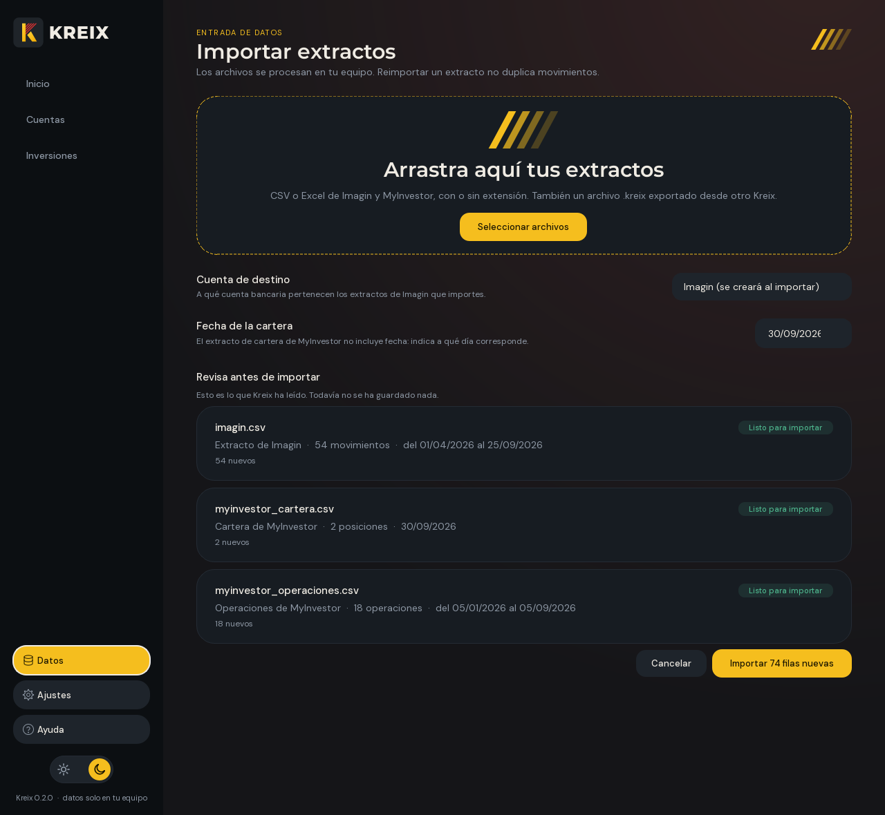

<p align="center">
  
</p>

<p align="center">
  Finanzas personales y cartera de inversión, 100 % offline y cifrada con contraseña maestra.<br>
  Importa tus extractos de <b>Imagin</b> y <b>MyInvestor</b> y ve tu patrimonio, tu ahorro y tu rentabilidad en un solo sitio.
</p>

<p align="center">
  
  
</p>

> Las capturas usan datos de demostración inventados (`tools/demo_data.py`).

## Qué hace

- **Importa extractos arrastrándolos a la ventana.** Kreix detecta el banco y el tipo de archivo por las cabeceras, no por el nombre ni la extensión, y **te enseña lo que ha leído antes de guardar nada**: cuántos movimientos, de qué fechas, cuántos son nuevos y cuántos ya estaban.
- **Pensado para no perderse:** una guía de tres pasos la primera vez, datos de ejemplo para explorar sin importar nada, una lista de primeros pasos en Inicio, una frase bajo cada gráfico que dice lo que cuenta y errores que explican qué hacer.
- **Todo se confirma y se puede deshacer:** cada cambio importante avisa con un mensaje breve y un botón **Deshacer** (importar, categorías, reglas, presupuestos, borrados...).
- **Búsqueda en todo (`Ctrl+K`):** páginas, acciones, movimientos y explicaciones de la ayuda.
- **Nunca duplica movimientos.** Puedes reimportar el mismo extracto, o varios que se solapan, y solo se añade lo nuevo. Dos pagos idénticos el mismo día se distinguen por el saldo posterior.
- **Categoriza los gastos** con reglas por palabras clave (supermercado, suscripciones, ocio, restaurantes, transporte, vivienda, salud, Bizum...) y **tú mandas**: cambia la categoría de un movimiento con clic derecho o crea tus propias reglas.
- **Presupuestos por categoría:** fija un tope mensual y mira cuánto llevas gastado; Inicio avisa de los que estás a punto de superar o ya has superado.
- **Pagos recurrentes:** detecta tus suscripciones y recibos mensuales, te dice cuánto suman al mes y al año y cuándo toca el siguiente.
- **Comparación con el mes anterior** en ingresos y gastos.
- **Calcula las métricas que importan:** patrimonio neto, rendimiento global, tasa de ahorro, TIR y TWR.
- **Una pestaña para tus cuentas y otra para tu inversión**, cada una con sus métricas, sus gráficos y todos sus movimientos, para un mes concreto o para todo el historial (ver más abajo).
- **Varias cuentas bancarias:** añade, renombra o elimina cuentas, y mira una sola o todas a la vez.
- **Avisa de lo que no cuadra** en vez de importar en silencio: saldos con huecos, cartera que no coincide con las operaciones, importes incoherentes.
- **Datos cifrados con contraseña maestra:** al abrir Kreix se pide una contraseña y tus datos solo se descifran en memoria; en disco hay únicamente un archivo `.krx` cifrado (ver *Seguridad*).
- **Evolución de cada fondo:** en Inversiones, una gráfica con el valor de cada fondo al cierre de cada mes, o de uno solo frente a lo aportado, calculada con tus propios extractos (nada sale del equipo).
- **Modo claro y oscuro** intercambiables en caliente (`Ctrl+T`), con la paleta amarilla y roja de la marca.
- **Fluido con muchos datos:** los movimientos se ordenan, filtran y cargan en una fracción de segundo incluso con decenas de miles de filas, solo se recalcula la página que estás viendo y la ventana recuerda su tamaño y la última página.
- **Privado por diseño:** todo se procesa y se guarda en tu equipo, cifrado. No hay red, cuentas ni telemetría.

## Las pestañas

Arriba a la izquierda están las tres vistas de tus datos; abajo, en forma de píldora con icono, las herramientas: **Datos** (al pasar el cursor, o al pulsarlo, despliega un submenú con *Importar* y *Exportar*), Ajustes y Ayuda, y debajo el conmutador de modo claro y oscuro (un sol y una luna).

| Pestaña | Para qué sirve |
|---|---|
| **Inicio** | Un saludo según la hora con tu nombre, patrimonio neto, rendimiento global y tasa de ahorro del mes; los próximos pagos recurrentes y los presupuestos del mes en riesgo; la distribución de activos y la evolución patrimonial. |
| **Cuentas** | Todo lo de tus cuentas bancarias: saldo, ingresos, gastos, tasa de ahorro, gasto medio, mayor gasto y categoría principal; gastos por categoría, evolución del saldo, ingresos y gastos por mes; presupuestos, pagos recurrentes y la tabla de movimientos. |
| **Inversiones** | Todo lo de tu cartera: valor, aportado, plusvalía, rentabilidad (TWR y TIR), distribución por fondo, aportado frente a valor, evolución de cada fondo, posiciones actuales y operaciones. |
| **Datos > Importar** | Arrastra extractos y elige a qué cuenta pertenecen. También restaura un archivo `.kreix`. |
| **Datos > Exportar** | Guarda todos tus datos en un único archivo `.kreix` para hacer una copia o llevarlos a otro ordenador. |
| **Ajustes** | Organizados en tarjetas por tema: tu nombre, idioma y lo que te interesa; ambiente y cálculo del ahorro; reglas de categorías; tus datos (ubicación, borrar todo) y novedades. |
| **Ayuda** | Qué significa cada cifra y cada gráfico, explicado sin tecnicismos y con ejemplos. |

Atajos: `Ctrl+1` a `Ctrl+7` cambian de página en el orden de la tabla (Importar y Exportar, que viven bajo *Datos*, son `Ctrl+4` y `Ctrl+5`), `Ctrl+K` busca en todo, `Ctrl+T` alterna el modo claro y oscuro, `Ctrl+F` va al buscador de movimientos y `F5` recalcula la página.

<p align="center">
  
  
</p>

**Lo que te interesa.** La primera vez, en el mismo cuadro donde Kreix te pregunta el nombre, eliges con dos interruptores si quieres gestionar **tus cuentas bancarias, tus inversiones o ambas cosas** (siempre queda al menos una). Inicio se adapta: sin inversiones no muestra el rendimiento ni el reparto de activos; sin cuentas no muestra la tasa de ahorro, el flujo de caja, los pagos recurrentes ni los presupuestos. Puedes cambiarlo en **Ajustes > Lo que te interesa**, y si entras en Cuentas o Inversiones y esa pestaña está desactivada, te ofrece un botón para activarla sin tocar la otra. Viaja con tus datos en el archivo `.kreix`.

**Un Inicio vivo.** Junto al saludo hay un cielo animado que recorre un ciclo completo y cerrado con la hora real, aunque dejes la app abierta: un sol que sale por la mañana y sube hasta el mediodía, el mismo sol bajando por la tarde hasta ponerse (de 6 a 21 h) y una luna con estrellas que sale al anochecer y se pone al amanecer (de 21 a 6 h); los rayos giran, pasa una nube y las estrellas centellean. La pantalla además baja su brillo muy ligeramente con la hora (como máximo un 7 %, sin cambiar de tema); ambas cosas se desactivan en **Ajustes > Ambiente**. El panel *Presupuestos del mes* muestra todos tus presupuestos de uno en uno, pasando solos cada pocos segundos; puedes pasarlos tú con las flechas, los puntos o las teclas ← →, y se detiene mientras tienes el ratón encima.

**Tres idiomas.** Kreix está en **castellano, català y English**. La primera vez eliges el idioma en el mismo cuadro donde te pregunta el nombre y lo que te interesa (se propone el del sistema y el cuadro cambia al instante); cada idioma lleva en un círculo la bandera de su país o región (España, la senyera y el Reino Unido). Se cambia cuando quieras en **Ajustes > Idioma**: toda la aplicación (menús, ayuda, avisos, errores, fechas y números) cambia sin perder tu sitio, y el idioma viaja con tus datos en el `.kreix`. En inglés los números se escriben como 1,234.56; en castellano y catalán, como 1.234,56.

**Fecha, hora y última actualización.** Debajo del saludo, Inicio muestra el día y la hora, siempre al día (por ejemplo, *Jueves 7 de Enero del 2027 - 20:20h*), y a continuación la *fecha de última actualización de datos* (el último día en que importaste algo). El saludo termina con un punto.

**Tu nombre.** Inicio te saluda según la hora (*Buenos días*, *Buenas tardes* o *Buenas noches*) seguido de tu nombre. Kreix te lo pregunta la primera vez que lo abres; puedes cambiarlo o quitarlo en **Ajustes > Tu nombre**. Se guarda con tus datos, así que viaja dentro del archivo `.kreix` al exportar y se recupera al importarlo en otro equipo, sin volver a preguntar.

**La primera vez.** Con la app vacía, la pantalla de inicio explica en tres pasos qué descargar y dónde soltarlo, y ofrece **Probar con datos de ejemplo**: datos inventados con un aviso arriba y un botón *Empezar con mis datos*. Se quitan solos al importar tus extractos reales, así que nunca se mezclan con los tuyos. Con datos ya cargados, Inicio muestra una lista de **primeros pasos** (importar la cuenta, las operaciones, la cartera, definir un presupuesto) que puedes ocultar.

**Revisar antes de importar.** Al soltar archivos, Kreix muestra una tarjeta por archivo (tipo, número de filas, fechas, nuevas, ya importadas y, en la cartera, las que se actualizan) y espera a que pulses *Importar*. Si un archivo no se puede leer, explica el motivo y qué hacer (por ejemplo, descargarlo otra vez en CSV o Excel sin editarlo). Un archivo `.kreix` se restaura directamente, con su propia confirmación.

**Avisos y Deshacer.** Tras cada cambio importante aparece un aviso abajo. Mientras siga a la vista, *Deshacer* devuelve los datos exactamente a como estaban: antes de cada cambio Kreix guarda una copia de la base de datos. Solo se deshace el último cambio.

**Evolución de cada fondo.** En Inversiones, la tarjeta *Evolución de cada fondo* dibuja una línea por fondo con su valor al cierre de cada mes (o, si eliges uno, su valor frente a lo aportado). Solo usa los extractos que ya importaste. El valor de un cierre de mes es una **estimación**: Kreix reconstruye las participaciones que tenías con tus operaciones y las multiplica por un precio interpolado entre los valores liquidativos que sí conoce (los de cada operación y los de cada extracto de cartera). Cuantos más extractos de cartera importes, más fiel es la curva.

**Ayuda.** Un menú de seis temas (Tu dinero de un vistazo, Tus cuentas bancarias, Tus inversiones, Rentabilidad, Avisos y Usar Kreix); cada botón abre su sección y una flecha vuelve al menú. Es un glosario para quien no sabe de finanzas: patrimonio neto, tasa de ahorro, valor liquidativo, plusvalía, TWR, TIR y el resto de términos que muestra Kreix. Cada término es una tarjeta con su explicación sencilla y, debajo, filas separadas con cómo lo calcula Kreix, un ejemplo, un aviso (*Ojo*) y un consejo (*Qué hacer*). Buscar "tir" encuentra la TIR, pero no "invertir".

**Exportar y mover tus datos.** *Exportar* crea un archivo `.kreix` (un ZIP con una copia consistente de la base de datos y una ficha con la versión y los totales). Para llevarlo a otro ordenador, instala Kreix allí, ve a *Importar* y arrastra el archivo: los datos quedan idénticos a los de origen (cuentas, movimientos, categorías, operaciones, cartera y ajustes, incluida la protección anti-duplicados). Importar un `.kreix` **reemplaza** los datos que hubiera en ese ordenador, y pide confirmación si ya había datos. Un archivo recibido se trata como no fiable: solo se aceptan sus dos entradas, se comprueba la integridad de la base de datos y se rechaza si trae disparadores o vistas, si es de una versión más reciente o si es demasiado grande. **El archivo no está cifrado**: contiene tu información financiera, guárdalo en un sitio seguro. (Al exportar no se escribe ningún archivo temporal en claro; el archivo `.kreix` es la única copia legible.)

<p align="center">
  
  
</p>

<p align="center">
  
  
</p>

**Por mes o en global.** En Cuentas e Inversión, el selector de arriba cambia entre "Todo el historial" y cada mes con datos (las flechas saltan al mes anterior o siguiente). Las métricas, los gráficos y las tablas se ajustan al periodo elegido:

- En Cuentas, el saldo es el **saldo al cierre** del mes y la media de gasto pasa de mensual a diaria.
- En Inversión, el mes muestra el valor estimado al cierre, lo aportado en el mes, la variación sin contar aportaciones y la rentabilidad del mes.

**Acciones visibles.** Cada movimiento tiene un botón **•••** (también doble clic o clic derecho) para cambiar su categoría, crear una regla o copiar el concepto. Pulsar una categoría en el gráfico de gastos, o un presupuesto, filtra la tabla con esos movimientos.

**Movimientos.** La tabla de Cuentas ordena los movimientos del más reciente al más antiguo y, dentro de un mismo día, en su orden real (se reconstruye con la cadena de saldos). Se puede buscar por concepto, filtrar por categoría y ordenar pulsando cualquier cabecera. Con varias cuentas aparece una columna "Cuenta".

**Categorías a tu gusto.** Con ••• (o clic derecho) sobre un movimiento: *Cambiar categoría* (tu elección no la pisa ninguna regla), *Volver a la categoría automática* o *Crear regla para…*, que lleva a una categoría todos los conceptos con esa palabra, también los que importes después. Tus reglas mandan sobre las que trae Kreix y se gestionan en **Ajustes > Reglas de categorías**.

**Presupuestos.** En Cuentas, el panel *Presupuestos* (botón *Definir presupuestos*) fija un tope mensual por categoría. La barra se pone verde mientras te sobra, amarilla al pasar del 85 % y roja al superarlo. Con un mes elegido compara el gasto de ese mes; con todo el historial, el gasto medio mensual.

**Pagos recurrentes.** Un cargo cuenta como recurrente si se repite al menos tres meses seguidos, cada unos 30 días y con un importe estable (hasta un 20 % de diferencia); si deja de aparecer durante mes y medio se da por cancelado. El supermercado no entra: varía de importe y se repite más de una vez al mes. Los traspasos, Bizum e ingresos nunca cuentan.

**Exportar movimientos.** El botón *Exportar* de la tabla guarda en CSV (UTF-8, separado por `;`, coma decimal) o Excel (importes como números) las filas que se ven, con el filtro y el orden actuales. No exporta a PDF.

**Varias cuentas.** En Cuentas, **Gestionar cuentas** permite añadir, renombrar y eliminar cuentas. En Importar eliges la cuenta de destino de cada extracto de Imagin. El mismo extracto importado en dos cuentas distintas no cuenta como duplicado. La cartera de inversión es una sola.

## Qué archivos acepta

| Origen | Archivo | Cabeceras que reconoce |
|---|---|---|
| Imagin | Extracto de movimientos (CSV o Excel) | `Concepto; Fecha; Importe; Saldo` |
| MyInvestor | Operaciones (CSV o Excel) | `Fecha Operación; ...; ISIN; Tipo Operación; Participaciones; ...` |
| MyInvestor | Cartera (CSV o Excel) | `Producto; ISIN; Participaciones Totales; ...; Valor Liquidativo Actual` |

- Admite CSV con `;`, `,` o tabulador, en UTF-8 o Windows-1252, y Excel con títulos antes de la tabla.
- **No importa la extensión:** archivos como `extractImagin` (sin extensión) o `.csv.txt` funcionan igual, porque el tipo se detecta por las cabeceras.
- Los importes en formato español (`-2,99EUR`, `1.234,56 €`) se limpian automáticamente.
- **Solo CSV y Excel:** Kreix no importa PDF. Descarga el extracto en uno de esos dos formatos desde tu banco.
- El extracto de cartera de MyInvestor no incluye fecha, así que Kreix te pide a qué día corresponde.

## Instalación y ejecución

Requiere Python 3.11 o superior (desarrollado y probado con 3.14). Es ligero: solo `PySide6-Essentials`, `SQLAlchemy`, `openpyxl` y `cryptography`, y arranca en alrededor de un segundo. (Kreix no usa pandas: los datos se procesan con código propio sobre SQLite.)

**En Windows, lo más fácil:** haz doble clic en `Kreix.bat`. La primera vez crea el entorno e instala lo necesario; después abre la aplicación directamente.

**A mano:**

```powershell
git clone https://github.com/dasuarezang/kreix.git
cd kreix
python -m venv .venv
.venv\Scripts\python -m pip install -r requirements.txt
.venv\Scripts\python main.py
```

En macOS o Linux usa `.venv/bin/python` en lugar de `.venv\Scripts\python`. Para desarrollar (tests, generar capturas y fuentes) instala `requirements-dev.txt`.

Si importaste algo mal, **Ajustes > Borrar todos los datos** deja la base de datos vacía (los ajustes se conservan) para volver a empezar.

Los datos se guardan, cifrados, en `%APPDATA%\Kreix\kreix.krx` (Windows), `~/Library/Application Support/Kreix/` (macOS) o `~/.local/share/Kreix/` (Linux). Para probar sin tocar tus datos:

```powershell
.venv\Scripts\python tools\demo_data.py demo          # genera extractos inventados en .\demo
.venv\Scripts\python main.py --db prueba.db           # base aparte, SIN cifrar (solo pruebas)
```

## Seguridad

Tus datos nunca se guardan en claro. La primera vez que abres Kreix creas una **contraseña maestra** (mínimo 8 caracteres); desde entonces se pide en una pantalla de bloqueo cada vez que abres la aplicación.

- **Cifrado:** la clave se deriva de la contraseña con PBKDF2-HMAC-SHA256 (600 000 vueltas y una sal aleatoria) y los datos se cifran con Fernet (AES con autenticación, de la biblioteca `cryptography`). Una contraseña incorrecta o un archivo alterado se rechazan.
- **En memoria:** al desbloquear, la base de datos se descifra directamente a la RAM, sin archivos temporales en claro. Kreix guarda el archivo `kreix.krx` cifrado unos segundos después de cada cambio y al cerrar (con escritura atómica y una copia `kreix.krx.bak`, también cifrada).
- **Copias de Deshacer:** se cifran con una clave aleatoria que solo existe en memoria durante la sesión.
- **Si vienes de una versión anterior:** la primera vez Kreix te pide crear la contraseña, cifra tu base `kreix.db`, comprueba que se abre y entonces la sobrescribe y borra.
- **Si olvidas la contraseña:** no hay forma de recuperar los datos. En la pantalla de bloqueo, **He olvidado la contraseña** borra el archivo cifrado (tras pedir confirmación) para empezar de cero con una contraseña nueva e importar de nuevo tus extractos.
- **Lo que no se cifra:** el archivo `.kreix` que exportas, y el archivo que importas mientras se valida. Trátalos como datos sensibles.

## Cómo se calculan las cifras

| Métrica | Definición |
|---|---|
| **Patrimonio neto** | Saldo de Imagin + valor de mercado de la última foto de cartera de cada fondo. |
| **Rendimiento global** | (valor de mercado - capital invertido) / capital invertido, según el extracto de cartera. |
| **Tasa de ahorro** | (ingresos - gastos) / ingresos del mes. Puede ser negativa. |
| **TIR** | Tasa interna de retorno anualizada con fechas irregulares (XIRR, base 365 días). |
| **TWR** | Rentabilidad ponderada en el tiempo: encadena los tramos entre aportaciones, así que el momento de aportar no la afecta. |

**Qué cuenta como ingreso o gasto**

- Los traspasos entre cuentas propias que **entran** cuentan como ingreso; los que salen son neutros. Es una opción en Ajustes.
- Los Bizum cuentan como ingreso o gasto. También es una opción en Ajustes.
- Las aportaciones a MyInvestor no son gasto: se calculan desde las compras de MyInvestor, para no contarlas dos veces.

**Fiabilidad.** La TIR y el TWR se reconstruyen desde el historial de operaciones. Si falta alguna, la cartera no cuadra con las operaciones: Kreix lo avisa y **oculta la TIR y el TWR** hasta que se corrija, en lugar de enseñar cifras engañosas. Exporta el historial completo desde el inicio.

## Arquitectura

Clean Architecture: las dependencias apuntan hacia el dominio, y `core` no sabe nada de la interfaz, de la base de datos ni de bibliotecas pesadas.

```
main.py                 ensambla las capas y arranca la interfaz
ui/                     PySide6: ventana, pantalla de bloqueo, vistas, gráficos, tema claro/oscuro
services/               casos de uso: importar, resumen, cuentas, inversión, categorías y presupuestos,
                        ajustes, exportar movimientos, exportar/restaurar
etl/                    lectores de CSV/Excel y parsers (Imagin, MyInvestor), cuadre
data/                   modelos SQLAlchemy, repositorios idempotentes, migraciones y almacén cifrado
                        (vault.py: PBKDF2 + Fernet; secure_store.py: base en memoria respaldada por el .krx)
core/                   lógica pura: métricas (generales, por cuenta y de inversión),
                        periodos, categorizador, pagos recurrentes, presupuestos, entidades, enumeraciones
logo-mejorado/          logotipos e iconos de la marca (SVG como fuente; `tools/build_logos.py` regenera PNG e .ico)
assets/fonts/           tipografías incluidas (Montserrat y DM Sans, licencia OFL)
tools/                  capturas, generador de fuentes y atajo para los datos de demostración
                        (la lógica de los datos de ejemplo vive en services/demo_data.py)
tests/                  suite de pruebas
```

Decisiones de diseño relevantes:

- **Dinero exacto.** Los importes se guardan como enteros escalados (x10⁶) mediante un tipo propio, `Decimal6`. No hay errores de coma flotante y `SUM()` sigue funcionando en SQL.
- **Idempotencia.** Cada movimiento tiene un `tx_hash` único (que incluye la cuenta) y se inserta con `ON CONFLICT DO NOTHING`. Las bases de datos anteriores se migran solas al abrir (`PRAGMA user_version`).
- **Cifrado en reposo sin tocar la lógica.** Los servicios siguen usando el mismo `Engine` de SQLAlchemy; por debajo es una base SQLite en memoria que se carga y se guarda cifrada (`data/secure_store.py`), así que ni los servicios ni las vistas saben que hay cifrado.
- **Fluidez.** Las tablas ordenan en el propio modelo (claves precalculadas y `list.sort`), no con el orden de Qt: 20 000 movimientos se ordenan en menos de medio segundo en lugar de cuatro. Las series de patrimonio ordenan una sola vez los saldos por cuenta y buscan por bisección, y solo se recalcula la página visible.
- **Gráficos propios**, pintados con QPainter (barras redondeadas con degradado, curvas suaves, donut con leyenda e importes), con animación de entrada y tarjeta de detalle al pasar el ratón. Se adaptan al tema activo.

## Diseño

- **Tipografía:** jerarquía estricta. Montserrat ExtraBold (la del logotipo) solo para las cifras principales (patrimonio, rendimiento...) y DM Sans para todo lo demás: regular y gris para las etiquetas, medium para títulos y controles. Los archivos van dentro del programa, así que se ve igual en cualquier ordenador. Ambas son libres (SIL Open Font License); las licencias están en `assets/fonts/LICENCIAS.txt`.
- **Color:** el amarillo vivo del logotipo (sin llegar a fluorescente) y un rojo intenso sobre carbón (modo oscuro) o papel cálido (modo claro). El amarillo se reserva para lo importante, el verde translúcido marca lo positivo y el rojo los gastos, los saldos negativos y las alertas.
- **Motivo de marca:** las cuatro franjas inclinadas de la K del logotipo (las cuatro barras de la senyera) aparecen en las cabeceras y en la zona de importación.
- **Aire y geometría:** márgenes generosos, esquinas muy redondeadas, líneas y barras finas con degradados casi transparentes e iconos lineales de trazo fino.
- **Estructura:** Ajustes y Ayuda agrupan la información en tarjetas con cabecera tintada, separadores finos y rótulos de grupo, para que cada bloque se vea aislado. Una cifra principal grande en Inicio y bandas de cifras en Cuentas e Inversiones, en lugar de muchas cajas iguales.

## Desarrollo

```powershell
.venv\Scripts\python -m pip install -r requirements-dev.txt
.venv\Scripts\python -m pytest -q          # toda la suite
.venv\Scripts\python tools\screenshots.py  # regenera las capturas del README
```

Los tests de interfaz usan Qt sin pantalla (`QT_QPA_PLATFORM=offscreen`) y simulan el arrastre de archivos. Las pruebas del ETL y de los servicios usan archivos de ejemplo inventados en `tests/fixtures/`.

## Hoja de ruta

- Migraciones de base de datos con Alembic.
- Cifrado opcional del archivo `.kreix` exportado y cambio de contraseña maestra desde Ajustes.
- Elegir varias cuentas a la vez (combinar solo algunas) en la pestaña Cuentas.
- Importar un CSV de histórico de precios para curvas diarias de cada fondo, sin salir a internet.
- Empaquetado como ejecutable (`.exe` / `.app`).
- Más idiomas (el catálogo de traducciones está en `core/locales/` y la ayuda en `ui/help_texts/`).
- Iconos «?» junto a cada cifra que abran su explicación en la Ayuda.

## Privacidad

Los extractos bancarios son datos sensibles. Tus datos locales van cifrados (`.krx`), pero el archivo `.kreix` exportado no lo está. El repositorio ignora por defecto las bases de datos (`*.db`), los almacenes cifrados (`*.krx`), los exportados (`*.kreix`) y las carpetas `ejemplos/` y `extractos/`. No subas extractos reales al control de versiones.

## Licencia

Proyecto privado. Todos los derechos reservados.
