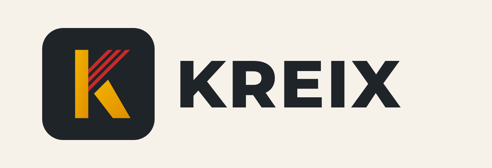
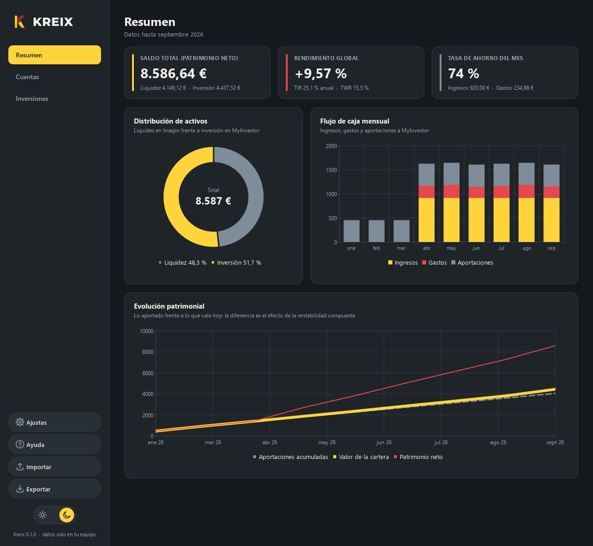
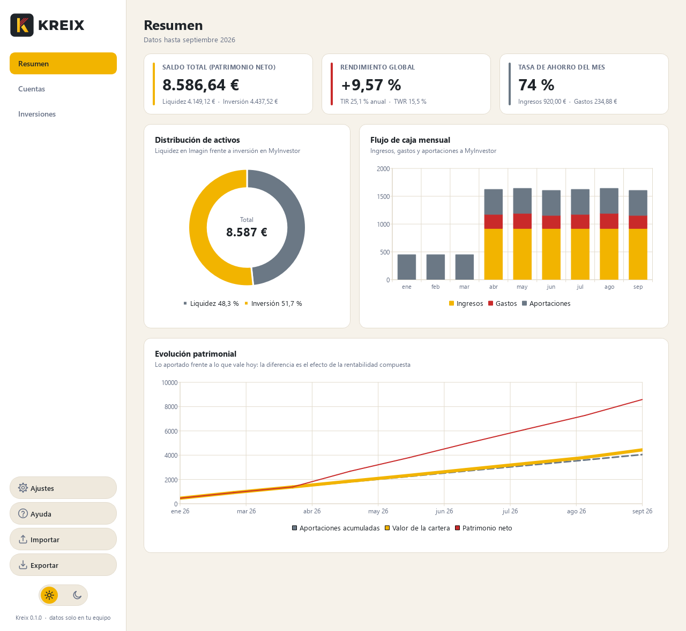
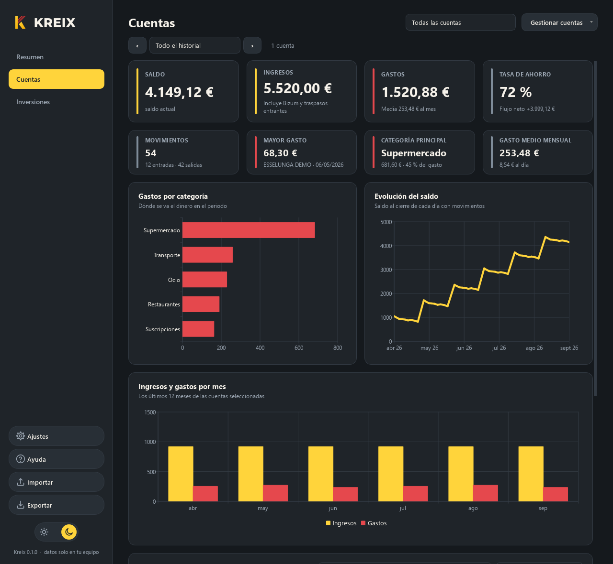
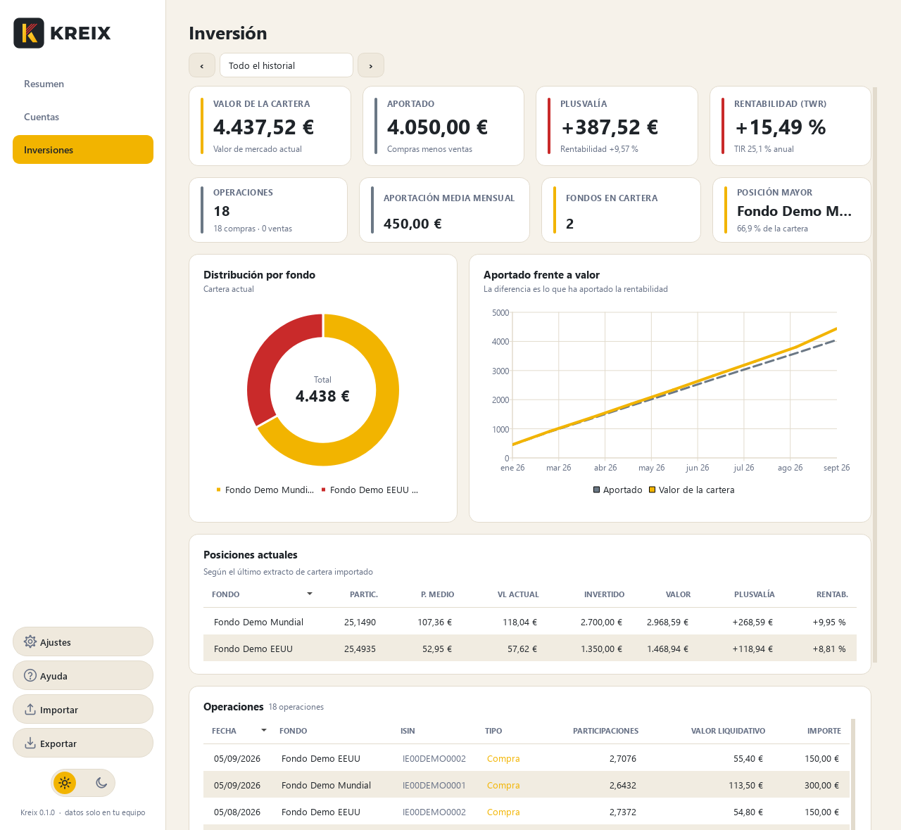
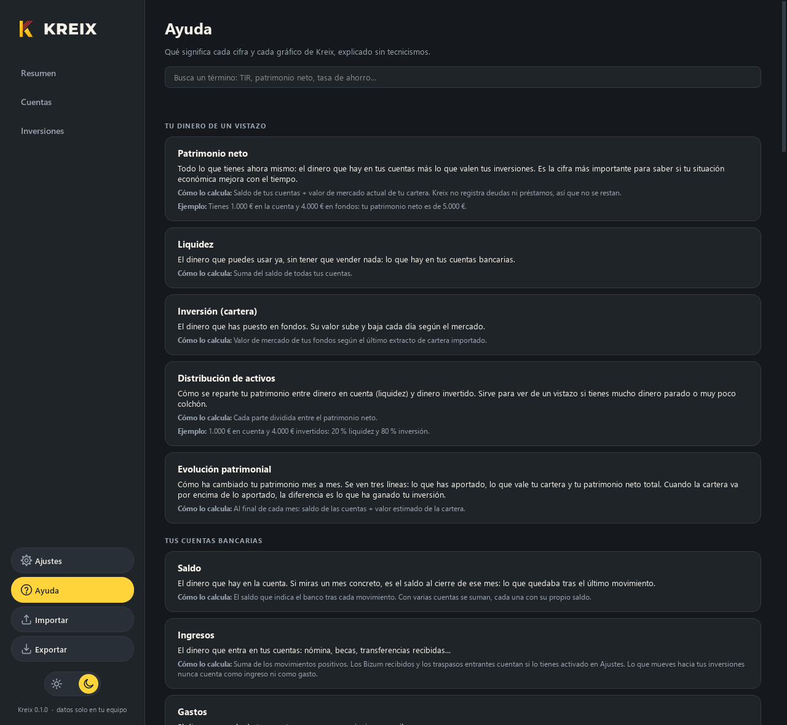
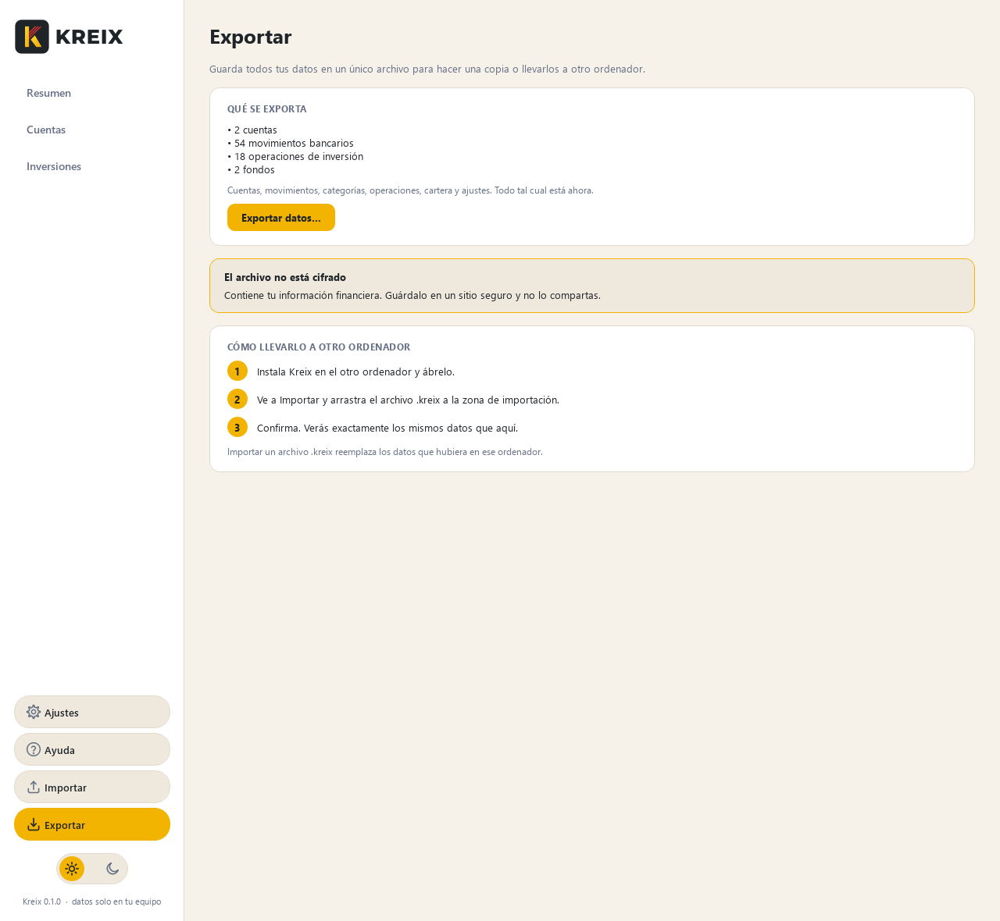

<p align="center">
  
</p>

<p align="center">
  Finanzas personales y cartera de inversión, 100 % offline.<br>
  Importa tus extractos de <b>Imagin</b> y <b>MyInvestor</b> y ve tu patrimonio, tu ahorro y tu rentabilidad en un solo sitio.
</p>

<p align="center">
  
  
</p>

> Las capturas usan datos de demostración inventados (`tools/demo_data.py`).

## Qué hace

- **Importa extractos arrastrándolos a la ventana.** Kreix detecta el banco y el tipo de archivo por las cabeceras, no por el nombre ni la extensión.
- **Nunca duplica movimientos.** Puedes reimportar el mismo extracto, o varios que se solapan, y solo se añade lo nuevo. Dos pagos idénticos el mismo día se distinguen por el saldo posterior.
- **Categoriza los gastos** con reglas por palabras clave (supermercado, suscripciones, ocio, restaurantes, transporte, vivienda, salud, Bizum...).
- **Calcula las métricas que importan:** patrimonio neto, rendimiento global, tasa de ahorro, TIR y TWR.
- **Una pestaña para tus cuentas y otra para tu inversión**, cada una con sus métricas, sus gráficos y todos sus movimientos, para un mes concreto o para todo el historial (ver más abajo).
- **Varias cuentas bancarias:** añade, renombra o elimina cuentas, y mira una sola o todas a la vez.
- **Avisa de lo que no cuadra** en vez de importar en silencio: saldos con huecos, cartera que no coincide con las operaciones, importes incoherentes.
- **Modo claro y oscuro** intercambiables en caliente (`Ctrl+T`), con la paleta amarilla y roja de la marca.
- **Privado por diseño:** todo se procesa y se guarda en tu equipo. No hay red, cuentas ni telemetría.

## Las pestañas

Arriba a la izquierda están las tres vistas de tus datos; abajo, en forma de píldora con icono, las herramientas, y debajo el conmutador de modo claro y oscuro (un sol y una luna).

| Pestaña | Para qué sirve |
|---|---|
| **Resumen** | Patrimonio neto, rendimiento global y tasa de ahorro del mes, con la distribución de activos y la evolución patrimonial. |
| **Cuentas** | Todo lo de tus cuentas bancarias: saldo, ingresos, gastos, tasa de ahorro, gasto medio, mayor gasto y categoría principal; gastos por categoría, evolución del saldo, ingresos y gastos por mes; y la tabla de movimientos. |
| **Inversiones** | Todo lo de tu cartera: valor, aportado, plusvalía, rentabilidad (TWR y TIR), distribución por fondo, aportado frente a valor, posiciones actuales y operaciones. |
| **Ajustes** | Qué cuenta como ingreso, borrar datos, ruta de la base de datos. |
| **Ayuda** | Qué significa cada cifra y cada gráfico, explicado sin tecnicismos y con ejemplos. Tiene buscador. |
| **Importar** | Arrastra extractos y elige a qué cuenta pertenecen. También restaura un archivo `.kreix`. |
| **Exportar** | Guarda todos tus datos en un único archivo `.kreix` para hacer una copia o llevarlos a otro ordenador. |

Atajos: `Ctrl+1` a `Ctrl+7` cambian de página en el orden de la tabla y `Ctrl+T` alterna el modo claro y oscuro.

**Ayuda.** Un glosario para quien no sabe de finanzas: patrimonio neto, tasa de ahorro, valor liquidativo, plusvalía, TWR, TIR y el resto de términos que muestra Kreix. Cada uno explica qué es, cómo lo calcula Kreix y da un ejemplo con números. Buscar "tir" encuentra la TIR, pero no "invertir".

**Exportar y mover tus datos.** *Exportar* crea un archivo `.kreix` (un ZIP con una copia consistente de la base de datos y una ficha con la versión y los totales). Para llevarlo a otro ordenador, instala Kreix allí, ve a *Importar* y arrastra el archivo: los datos quedan idénticos a los de origen (cuentas, movimientos, categorías, operaciones, cartera y ajustes, incluida la protección anti-duplicados). Importar un `.kreix` **reemplaza** los datos que hubiera en ese ordenador, y pide confirmación si ya había datos. Un archivo recibido se trata como no fiable: solo se aceptan sus dos entradas, se comprueba la integridad de la base de datos y se rechaza si trae disparadores o vistas, si es de una versión más reciente o si es demasiado grande. **El archivo no está cifrado**: contiene tu información financiera, guárdalo en un sitio seguro.

<p align="center">
  
  
</p>

<p align="center">
  
  
</p>

**Por mes o en global.** En Cuentas e Inversión, el selector de arriba cambia entre "Todo el historial" y cada mes con datos (las flechas saltan al mes anterior o siguiente). Las métricas, los gráficos y las tablas se ajustan al periodo elegido:

- En Cuentas, el saldo es el **saldo al cierre** del mes y la media de gasto pasa de mensual a diaria.
- En Inversión, el mes muestra el valor estimado al cierre, lo aportado en el mes, la variación sin contar aportaciones y la rentabilidad del mes.

**Movimientos.** La tabla de Cuentas ordena los movimientos del más reciente al más antiguo y, dentro de un mismo día, en su orden real (se reconstruye con la cadena de saldos). Se puede buscar por concepto, filtrar por categoría y ordenar pulsando cualquier cabecera. Con varias cuentas aparece una columna "Cuenta".

**Varias cuentas.** En Cuentas, **Gestionar cuentas** permite añadir, renombrar y eliminar cuentas. En Importar eliges la cuenta de destino de cada extracto de Imagin. El mismo extracto importado en dos cuentas distintas no cuenta como duplicado. La cartera de inversión es una sola.

## Qué archivos acepta

| Origen | Archivo | Cabeceras que reconoce |
|---|---|---|
| Imagin | Extracto de movimientos (CSV o Excel) | `Concepto; Fecha; Importe; Saldo` |
| MyInvestor | Operaciones (CSV o Excel) | `Fecha Operación; ...; ISIN; Tipo Operación; Participaciones; ...` |
| MyInvestor | Cartera (CSV o Excel) | `Producto; ISIN; Participaciones Totales; ...; Valor Liquidativo Actual` |

- Admite CSV con `;`, `,` o tabulador, en UTF-8 o Windows-1252, y Excel con títulos antes de la tabla.
- **No importa la extensión:** archivos como `extractImagin` (sin extensión) o `.csv.txt` funcionan igual, porque el tipo se detecta por las cabeceras.
- Los importes en formato español (`-2,99EUR`, `1.234,56 €`) se limpian automáticamente.
- **Los PDF todavía no se pueden importar.** Descarga el extracto en CSV o Excel desde tu banco.
- El extracto de cartera de MyInvestor no incluye fecha, así que Kreix te pide a qué día corresponde.

## Instalación

Requiere Python 3.11 o superior (desarrollado y probado con 3.14).

```powershell
git clone https://github.com/dasuarezang/kreix.git
cd kreix
python -m venv .venv
.venv\Scripts\python -m pip install -r requirements.txt
.venv\Scripts\python main.py
```

En macOS o Linux usa `.venv/bin/python` en lugar de `.venv\Scripts\python`.

Si importaste algo mal, **Ajustes > Borrar todos los datos** deja la base de datos vacía (los ajustes se conservan) para volver a empezar.

Los datos se guardan en `%APPDATA%\Kreix\kreix.db` (Windows), `~/Library/Application Support/Kreix/` (macOS) o `~/.local/share/Kreix/` (Linux). Para probar sin tocar tus datos:

```powershell
.venv\Scripts\python tools\demo_data.py demo          # genera extractos inventados en .\demo
.venv\Scripts\python main.py --db prueba.db           # usa una base de datos aparte
```

## Cómo se calculan las cifras

| Métrica | Definición |
|---|---|
| **Patrimonio neto** | Saldo de Imagin + valor de mercado de la última foto de cartera de cada fondo. |
| **Rendimiento global** | (valor de mercado - capital invertido) / capital invertido, según el extracto de cartera. |
| **Tasa de ahorro** | (ingresos - gastos) / ingresos del mes. Puede ser negativa. |
| **TIR** | Tasa interna de retorno anualizada con fechas irregulares (XIRR, base 365 días). |
| **TWR** | Rentabilidad ponderada en el tiempo: encadena los tramos entre aportaciones, así que el momento de aportar no la afecta. |

**Qué cuenta como ingreso o gasto**

- Los traspasos entre cuentas propias que **entran** cuentan como ingreso; los que salen son neutros. Es una opción en Ajustes.
- Los Bizum cuentan como ingreso o gasto. También es una opción en Ajustes.
- Las aportaciones a MyInvestor no son gasto: se calculan desde las compras de MyInvestor, para no contarlas dos veces.

**Fiabilidad.** La TIR y el TWR se reconstruyen desde el historial de operaciones. Si falta alguna, la cartera no cuadra con las operaciones: Kreix lo avisa y **oculta la TIR y el TWR** hasta que se corrija, en lugar de enseñar cifras engañosas. Exporta el historial completo desde el inicio.

## Arquitectura

Clean Architecture: las dependencias apuntan hacia el dominio, y `core` no sabe nada de la interfaz, de la base de datos ni de pandas.

```
main.py                 ensambla las capas y arranca la interfaz
ui/                     PySide6: ventana, vistas, gráficos, tema claro/oscuro
services/               casos de uso: importar, resumen, cuentas, inversión, ajustes, exportar/restaurar
etl/                    lectores de CSV/Excel y parsers (Imagin, MyInvestor), cuadre
data/                   modelos SQLAlchemy, repositorios idempotentes y migraciones
core/                   lógica pura: métricas (generales, por cuenta y de inversión),
                        periodos, categorizador, entidades, enumeraciones
logo-mejorado/          logotipos e iconos de la marca
tools/                  datos de demostración y generador de capturas
tests/                  suite de pruebas
```

Decisiones de diseño relevantes:

- **Dinero exacto.** Los importes se guardan como enteros escalados (x10⁶) mediante un tipo propio, `Decimal6`. No hay errores de coma flotante y `SUM()` sigue funcionando en SQL.
- **Idempotencia.** Cada movimiento tiene un `tx_hash` único (que incluye la cuenta) y se inserta con `ON CONFLICT DO NOTHING`. Las bases de datos anteriores se migran solas al abrir (`PRAGMA user_version`).
- **Preparado para cifrar.** El motor se crea en un único punto (`make_engine`), así que cambiar a una base cifrada (SQLCipher) no toca el resto del código.
- **Gráficos nativos** (QtCharts), redibujados al cambiar de tema, con tooltips al pasar el ratón.

## Desarrollo

```powershell
.venv\Scripts\python -m pytest -q          # toda la suite
.venv\Scripts\python tools\screenshots.py  # regenera las capturas del README
```

Los tests de interfaz usan Qt sin pantalla (`QT_QPA_PLATFORM=offscreen`) y simulan el arrastre de archivos. Las pruebas del ETL y de los servicios usan archivos de ejemplo inventados en `tests/fixtures/`.

## Hoja de ruta

- Importar extractos en PDF.
- Migraciones de base de datos con Alembic.
- Cifrado de la base de datos y del archivo `.kreix` exportado.
- Reglas de categorización editables desde la interfaz.
- Empaquetado como ejecutable (`.exe` / `.app`).

## Privacidad

Los extractos bancarios son datos sensibles, y el archivo `.kreix` exportado también (no está cifrado). El repositorio ignora por defecto las bases de datos (`*.db`) y la carpeta `ejemplos/`. No subas extractos reales al control de versiones.

## Licencia

Proyecto privado. Todos los derechos reservados.
